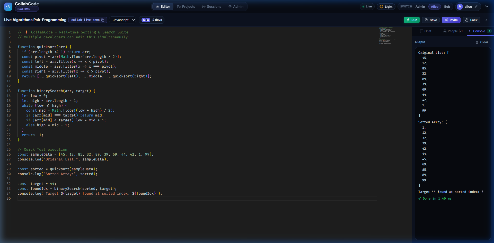
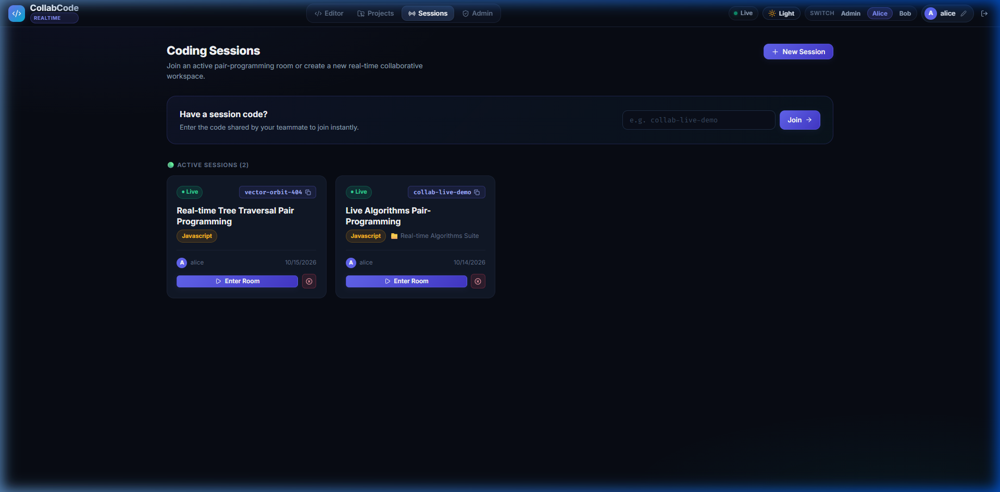
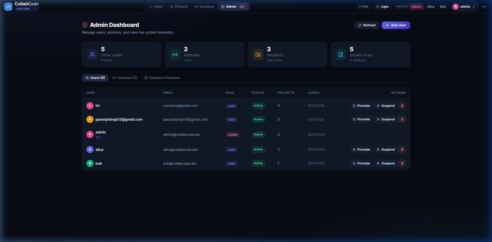
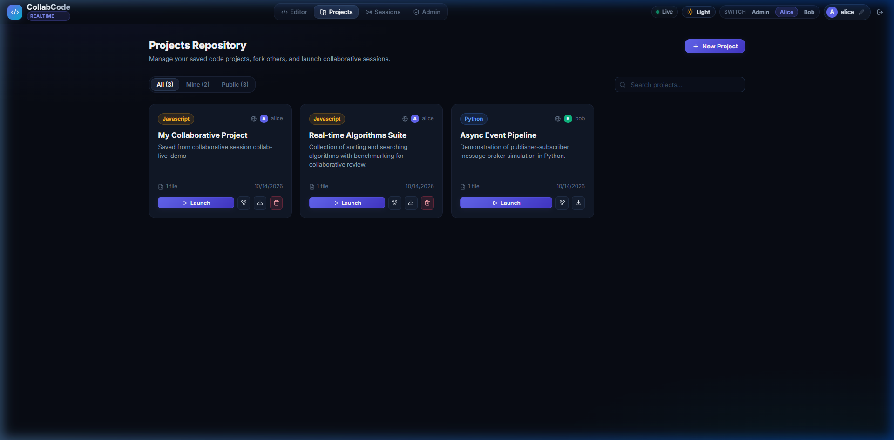
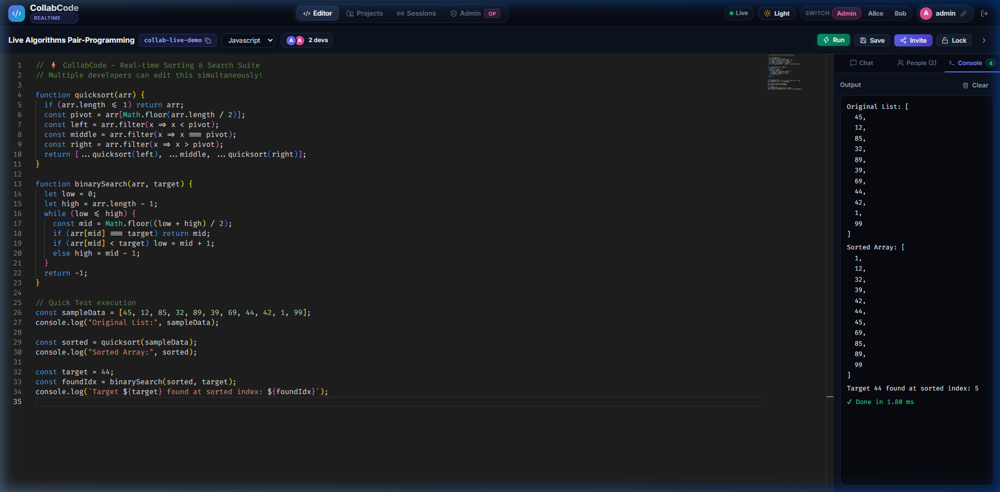
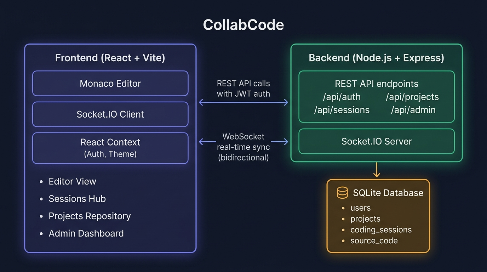

<div align="center">

# ⚡ CollabCode

### Real-Time Collaborative Code Editor & Workspace

A full-stack, production-quality collaborative coding platform where multiple developers can **write, run, and review code simultaneously** — powered by Monaco Editor, Socket.IO, React, Node.js, and SQLite.

[](https://nodejs.org/)
[](https://react.dev/)
[](https://socket.io/)
[](https://vitejs.dev/)
[](https://www.sqlite.org/)
[](LICENSE)

</div>

---

## 📸 Screenshots

### 🖥️ Collaborative Code Editor
> Monaco Editor (VS Code engine) with real-time sync, live chat sidebar, collaborator presence avatars, and in-browser code runner.



---

### 🏠 Sessions Hub
> Browse active coding rooms, accept pending invitations, or join any room with a session code in one click.



---

### 👑 Admin Dashboard
> Full user management, live session telemetry, role controls, and visual database schema overview.



---

### 📁 Projects Repository
> Save, fork, download, and launch collaborative sessions directly from your project library.



---

### ⚡ In-Browser Code Runner
> Execute JavaScript instantly in a sandboxed environment with captured `console.log`, return values, timing, and error traces.



---

## 🏗️ Architecture



---

## 📂 Project Structure

```
CollabCode/
├── client/                        # React + Vite frontend
│   └── src/
│       ├── views/
│       │   ├── EditorView.jsx         # Main collaborative editor
│       │   ├── SessionsHubView.jsx    # Session browser & invitations
│       │   ├── ProjectsView.jsx       # Project repository
│       │   └── AdminView.jsx          # Admin dashboard
│       ├── components/
│       │   ├── AuthModal.jsx          # Login / Register / Demo Switcher
│       │   ├── InviteModal.jsx        # Collaborator invitation flow
│       │   ├── NewSessionModal.jsx    # Session creation
│       │   ├── SaveProjectModal.jsx   # Save session as project
│       │   ├── JoinGate.jsx           # Invite-link access gate
│       │   └── Navbar.jsx             # Navigation bar & persona switcher
│       ├── context/
│       │   ├── AuthContext.jsx        # JWT auth state & user management
│       │   └── ThemeContext.jsx       # Light / dark theme toggle
│       └── services/
│           ├── api.js                 # REST API client wrapper
│           └── socket.js              # Socket.IO client singleton
│
└── server/                        # Node.js + Express backend
    ├── server.js                  # App entry point, CORS, route mounting
    ├── db.js                      # SQLite schema init & seed data
    ├── socketHandler.js           # Real-time collaboration engine
    └── routes/
        ├── auth.js                # /api/auth
        ├── sessions.js            # /api/sessions
        ├── projects.js            # /api/projects
        └── admin.js               # /api/admin
```

---

## 🚀 Features

### 💻 Collaborative Code Editor
- **Monaco Editor** — the same engine powering VS Code — with syntax highlighting, IntelliSense, minimap, and Fira Code ligatures
- **Ultra-fast real-time sync** via Socket.IO WebSockets; code changes broadcast to all peers in under 50 ms with debounced SQLite persistence
- **Multi-user cursor presence** — see every collaborator's cursor position and avatar in real time
- **Collaborator presence cluster** — live avatar stack in the toolbar with participant count
- **Language selector** — switch between `JavaScript`, `Python`, `TypeScript`, `HTML`, `CSS`, `JSON` on the fly
- **Session lock / unlock** — hosts can toggle read-only mode for demos or coding interviews
- **Session code badge** — 1-click copy the room code to share with teammates
- **Light & dark theme** support reflected in both the app UI and Monaco editor

### 🏠 Sessions Hub
- Browse all **active** and **past** coding sessions in a responsive card grid
- **Quick join** — paste any session code to enter instantly
- **Pending invitation inbox** — prominently displayed invite cards with Accept & Join / Decline controls
- Create new sessions with a custom title and language preset
- Host controls to end a live session from the session card

### 📁 Projects Repository
- Save any live session snapshot to a persistent **project** with title, description, and language
- **Filter** by All / My Projects / Public and **search** by name or description
- **Fork** any public project into your personal workspace with 1 click
- **Download** source code file directly to disk
- **Launch** a brand-new live collaborative session pre-loaded with project code
- **Public / Private** visibility toggle per project

### 👑 Admin Dashboard *(admin role only)*
- **Live stats cards** — Total Users, Active Sessions, Total Projects, Source Files
- **User management table** — promote/demote roles, suspend/activate accounts, create or delete users
- **Session management table** — inspect all live and historical sessions, force-terminate any active session with real-time WebSocket broadcast to connected peers
- **Database Overview** — visual SQLite schema telemetry with record counts per table

### 🔥 Bonus Features
- **In-Browser Code Runner** — execute JavaScript natively with captured `console.log`, `console.warn`, `console.error`, return values, and execution time in ms
- **Real-time in-session chat** — persistent live chat sidebar with unread message counter badge
- **1-Click Persona Switcher** — switch between Admin, Alice, and Bob demo accounts from the navbar without entering a password; perfect for testing multi-user collaboration in two browser tabs

---

## 🗄️ Database Schema

```sql
-- 1. Users
CREATE TABLE users (
  id            INTEGER PRIMARY KEY AUTOINCREMENT,
  username      TEXT UNIQUE NOT NULL,
  email         TEXT UNIQUE NOT NULL,
  password_hash TEXT NOT NULL,
  role          TEXT DEFAULT 'user'   CHECK(role   IN ('admin', 'user')),
  status        TEXT DEFAULT 'active' CHECK(status IN ('active', 'suspended')),
  avatar_color  TEXT DEFAULT '#6366f1',
  created_at    DATETIME DEFAULT CURRENT_TIMESTAMP
);

-- 2. Projects
CREATE TABLE projects (
  id          INTEGER PRIMARY KEY AUTOINCREMENT,
  name        TEXT NOT NULL,
  description TEXT,
  owner_id    INTEGER NOT NULL REFERENCES users(id) ON DELETE CASCADE,
  language    TEXT DEFAULT 'javascript',
  is_public   INTEGER DEFAULT 1,
  created_at  DATETIME DEFAULT CURRENT_TIMESTAMP,
  updated_at  DATETIME DEFAULT CURRENT_TIMESTAMP
);

-- 3. Coding Sessions
CREATE TABLE coding_sessions (
  id           INTEGER PRIMARY KEY AUTOINCREMENT,
  session_code TEXT UNIQUE NOT NULL,
  project_id   INTEGER REFERENCES projects(id) ON DELETE SET NULL,
  host_user_id INTEGER NOT NULL REFERENCES users(id) ON DELETE CASCADE,
  title        TEXT NOT NULL,
  language     TEXT DEFAULT 'javascript',
  is_active    INTEGER DEFAULT 1,
  is_locked    INTEGER DEFAULT 0,
  created_at   DATETIME DEFAULT CURRENT_TIMESTAMP,
  ended_at     DATETIME
);

-- 4. Source Code
CREATE TABLE source_code (
  id               INTEGER PRIMARY KEY AUTOINCREMENT,
  project_id       INTEGER REFERENCES projects(id)        ON DELETE CASCADE,
  session_id       INTEGER REFERENCES coding_sessions(id) ON DELETE CASCADE,
  file_name        TEXT NOT NULL DEFAULT 'main.js',
  language         TEXT DEFAULT 'javascript',
  content          TEXT DEFAULT '',
  version          INTEGER DEFAULT 1,
  last_modified_by INTEGER REFERENCES users(id) ON DELETE SET NULL,
  updated_at       DATETIME DEFAULT CURRENT_TIMESTAMP
);

-- 5. Session Invites
CREATE TABLE session_invites (
  id            INTEGER PRIMARY KEY AUTOINCREMENT,
  session_id    INTEGER NOT NULL REFERENCES coding_sessions(id) ON DELETE CASCADE,
  invited_email TEXT NOT NULL,
  status        TEXT DEFAULT 'pending' CHECK(status IN ('pending', 'accepted', 'revoked')),
  created_at    DATETIME DEFAULT CURRENT_TIMESTAMP
);

-- 6. Chat Messages
CREATE TABLE chat_messages (
  id         INTEGER PRIMARY KEY AUTOINCREMENT,
  session_id INTEGER NOT NULL REFERENCES coding_sessions(id) ON DELETE CASCADE,
  user_id    INTEGER NOT NULL REFERENCES users(id) ON DELETE CASCADE,
  message    TEXT NOT NULL,
  created_at DATETIME DEFAULT CURRENT_TIMESTAMP
);
```

---

## 🔑 Pre-Seeded Demo Accounts

| Persona | Username | Email | Password | Role | Capabilities |
|:---:|:---:|:---|:---:|:---:|:---|
| 👑 **Admin** | `admin` | `admin@collabcode.dev` | `admin123` | `admin` | Full user & session administration, force-terminate sessions, create users |
| 👩‍💻 **Alice** | `alice` | `alice@collabcode.dev` | `alice123` | `user` | Standard developer, default live session host |
| 👨‍💻 **Bob** | `bob` | `bob@collabcode.dev` | `bob123` | `user` | Collaborator, pair-programming peer |

> 💡 **Tip:** Use the **Quick Persona Switcher** in the top navbar to switch between accounts instantly — no passwords needed. Open two browser tabs to simulate real multi-user collaboration!

---

## 🛠️ Local Setup

### Prerequisites
- **Node.js** `>= 22` (uses the built-in `node:sqlite` module — no extra DB driver needed)
- **npm** `>= 10`

### 1. Clone the Repository
```bash
git clone https://github.com/your-username/CollabCode.git
cd CollabCode
```

### 2. Start the Backend (Port 5000)
```bash
cd server
npm install
npm run dev
```
> The server auto-seeds the database with demo users, projects, and an active session on first run.
> API available at: **http://localhost:5000**

### 3. Start the Frontend (Port 5173)
```bash
# Open a new terminal
cd client
npm install
npm run dev
```
> Open **http://localhost:5173** in your browser.

### Environment Variables *(Optional)*
Create `server/.env` to override defaults:
```env
PORT=5000
JWT_SECRET=your_super_secret_key_here
```

---

## 🔌 API Reference

### Auth — `/api/auth`
| Method | Endpoint | Description | Access |
|:---:|:---|:---|:---:|
| `POST` | `/api/auth/register` | Register a new user account | 🌐 Public |
| `POST` | `/api/auth/login` | Login and receive JWT token | 🌐 Public |
| `GET` | `/api/auth/me` | Get the current authenticated user | 🔒 JWT Required |
| `PUT` | `/api/auth/profile` | Update display name or avatar color | 🔒 JWT Required |
| `POST` | `/api/auth/quick-switch` | Switch to a demo persona | 🌐 Public |

### Sessions — `/api/sessions`
| Method | Endpoint | Description | Access |
|:---:|:---|:---|:---:|
| `GET` | `/api/sessions` | List all sessions (active + past) | 🌐 Public |
| `POST` | `/api/sessions` | Create a new coding session | 🔒 JWT Required |
| `GET` | `/api/sessions/:code` | Get session details, files, chats, invites | 🌐 Public |
| `POST` | `/api/sessions/:code/end` | End a session (host only) | 🔒 JWT Required |
| `POST` | `/api/sessions/:code/lock` | Toggle session read-only lock | 🔒 JWT Required |
| `POST` | `/api/sessions/:code/invite` | Send invitation by email | 🔒 JWT Required |
| `GET` | `/api/sessions/my-invites` | Get pending invites for current user | 🔒 JWT Required |
| `POST` | `/api/sessions/invites/:id/accept` | Accept a pending invite | 🔒 JWT Required |
| `POST` | `/api/sessions/invites/:id/decline` | Decline a pending invite | 🔒 JWT Required |

### Projects — `/api/projects`
| Method | Endpoint | Description | Access |
|:---:|:---|:---|:---:|
| `GET` | `/api/projects` | List all accessible projects | 🌐 Public |
| `POST` | `/api/projects` | Create a new project | 🔒 JWT Required |
| `GET` | `/api/projects/:id` | Get project details with source files | 🌐 Public |
| `DELETE` | `/api/projects/:id` | Delete a project (owner/admin) | 🔒 JWT Required |
| `POST` | `/api/projects/:id/fork` | Fork a project into personal workspace | 🔒 JWT Required |
| `POST` | `/api/projects/save-session` | Save a live session as a project | 🔒 JWT Required |

### Admin — `/api/admin` *(admin role required)*
| Method | Endpoint | Description | Access |
|:---:|:---|:---|:---:|
| `GET` | `/api/admin/stats` | System-wide telemetry and record counts | 👑 Admin JWT |
| `GET` | `/api/admin/users` | List all registered users | 👑 Admin JWT |
| `POST` | `/api/admin/users` | Create a user directly | 👑 Admin JWT |
| `PUT` | `/api/admin/users/:id/role` | Promote or demote a user's role | 👑 Admin JWT |
| `PUT` | `/api/admin/users/:id/status` | Suspend or activate an account | 👑 Admin JWT |
| `DELETE` | `/api/admin/users/:id` | Permanently delete a user | 👑 Admin JWT |
| `GET` | `/api/admin/sessions` | List all sessions | 👑 Admin JWT |
| `POST` | `/api/admin/sessions/:id/terminate` | Force-terminate a live session | 👑 Admin JWT |
| `DELETE` | `/api/admin/sessions/:id` | Delete a session record | 👑 Admin JWT |

---

## 🔄 Socket.IO Real-Time Events

### Client → Server
| Event | Payload | Description |
|:---|:---|:---|
| `join_session` | `{ sessionCode, user }` | Join a collaborative room |
| `code_change` | `{ sessionCode, content, senderId }` | Broadcast a code edit to peers |
| `cursor_move` | `{ sessionCode, position, selection }` | Broadcast cursor position |
| `send_chat` | `{ sessionCode, message }` | Send a chat message |
| `toggle_lock` | `{ sessionCode, isLocked }` | Toggle session read-only state |
| `update_user_profile` | `{ sessionCode, user }` | Broadcast profile name/color change |

### Server → Client
| Event | Payload | Description |
|:---|:---|:---|
| `session_init` | `{ content, isLocked, participants }` | Full initial state on join |
| `code_update` | `{ content, senderId }` | Code change from another peer |
| `cursor_update` | `{ socketId, user, position }` | Cursor move from another peer |
| `user_joined` | `{ user, participants }` | A new collaborator entered the room |
| `user_left` | `{ user, participants }` | A collaborator disconnected |
| `participants_updated` | `{ participants, updatedUser }` | Participant list refreshed |
| `new_chat_message` | `{ id, message, user, created_at }` | Incoming chat message |
| `lock_state_changed` | `{ isLocked }` | Session lock state toggled |
| `session_terminated_by_admin` | `{ message }` | Admin force-terminated the session |

---

## 🧰 Tech Stack

| Layer | Technology |
|:---|:---|
| **Frontend Framework** | React 19 + Vite 8 |
| **Code Editor** | `@monaco-editor/react` (Monaco / VS Code engine) |
| **Real-Time Transport** | Socket.IO 4.x (WebSockets) |
| **Icons** | Lucide React |
| **Styling** | Vanilla CSS with CSS custom properties & glassmorphism |
| **Backend Runtime** | Node.js 22+ (CommonJS) |
| **HTTP Server** | Express 5 |
| **Authentication** | JWT (`jsonwebtoken`) + bcrypt password hashing |
| **Database** | SQLite via built-in `node:sqlite` (no extra drivers needed) |
| **Dev Server** | Nodemon (server hot-reload) |

---

## 📝 License

This project is licensed under the **MIT License** — see the [LICENSE](LICENSE) file for details.

---

<div align="center">

Built with ❤️ using **React**, **Monaco Editor**, **Socket.IO**, **Express**, and **SQLite**

⭐ Star this repo if you found it helpful!

</div>

---

## 🚀 Key Modules & Capabilities

### 👑 Admin Module
- **Manage Users**:
  - View all registered users with system activity (projects count, sessions hosted, creation date).
  - Promote / Demote user roles (`admin` ↔ `user`).
  - Toggle user account status (`active` ↔ `suspended`).
  - Create new users directly with temporary credentials.
  - Delete user accounts with safety checks.
- **Manage Coding Sessions**:
  - Live inspection of all active and historical sessions.
  - Force-terminate any live session in real time with WebSocket broadcast to connected peers.
  - Delete sessions and inspect host participant logs.
- **Database & Telemetry Overview**:
  - Live table statistics and schema telemetry for all 4 primary database tables.

---

### 💻 User Module
- **Create Coding Session**:
  - Spin up live collaborative rooms with custom titles and language presets (`JavaScript`, `Python`, `TypeScript`, `HTML`, `CSS`, `JSON`).
  - Optionally preload code from an existing saved project.
- **Invite Collaborators**:
  - Generate instant shareable session invite links (`?session=code`).
  - 1-click copy session code badge.
  - In-app and email collaborator invitations with status tracking (`pending`, `accepted`).
- **Edit Code (Real-Time)**:
  - Monaco code editor (same engine powering VS Code) with syntax highlighting, line numbers, and minimap.
  - Ultra-fast real-time synchronization across multiple collaborators via Socket.IO.
  - Multi-user cursor tracking and active collaborator presence list with custom avatar colors.
  - Host session lock / unlock toggle (set read-only mode for demonstrations or pair-programming interviews).
- **Save Projects**:
  - Save any live collaborative session snapshot directly into the permanent `projects` and `source_code` database tables.
  - Manage saved projects repository (filter by My Projects, Public Projects, All).
  - Launch brand new live coding sessions directly from any saved project.
  - Fork projects into personal workspace or download source code files locally with 1 click.

---

### 🌟 Bonus Features Included
- **In-Browser Code Runner Sandbox**:
  - Click **"Run Code"** to execute JavaScript or Python scripts in a safe client sandbox with captured standard output, return values, runtime duration in milliseconds, and formatted error stack traces.
- **Real-Time In-Session Chat**:
  - Instant live messaging sidebar with user timestamps and unread message counter badge.
- **1-Click Persona Switcher**:
  - Easily toggle between `Admin`, `Alice`, and `Bob` in 1 click from the navigation bar to test multi-user pairing in two tabs or windows without typing passwords!

---

## 🗄️ Relational Database Schema (`collabcode.db`)

The database consists of the 4 requested tables:

```sql
-- 1. Users Table
CREATE TABLE users (
  id INTEGER PRIMARY KEY AUTOINCREMENT,
  username TEXT UNIQUE NOT NULL,
  email TEXT UNIQUE NOT NULL,
  password_hash TEXT NOT NULL,
  role TEXT DEFAULT 'user' CHECK(role IN ('admin', 'user')),
  status TEXT DEFAULT 'active' CHECK(status IN ('active', 'suspended')),
  avatar_color TEXT DEFAULT '#6366f1',
  created_at DATETIME DEFAULT CURRENT_TIMESTAMP
);

-- 2. Project Table
CREATE TABLE projects (
  id INTEGER PRIMARY KEY AUTOINCREMENT,
  name TEXT NOT NULL,
  description TEXT,
  owner_id INTEGER NOT NULL,
  language TEXT DEFAULT 'javascript',
  is_public INTEGER DEFAULT 1,
  created_at DATETIME DEFAULT CURRENT_TIMESTAMP,
  updated_at DATETIME DEFAULT CURRENT_TIMESTAMP,
  FOREIGN KEY (owner_id) REFERENCES users(id) ON DELETE CASCADE
);

-- 3. Coding Sessions Table
CREATE TABLE coding_sessions (
  id INTEGER PRIMARY KEY AUTOINCREMENT,
  session_code TEXT UNIQUE NOT NULL,
  project_id INTEGER,
  host_user_id INTEGER NOT NULL,
  title TEXT NOT NULL,
  language TEXT DEFAULT 'javascript',
  is_active INTEGER DEFAULT 1,
  is_locked INTEGER DEFAULT 0,
  created_at DATETIME DEFAULT CURRENT_TIMESTAMP,
  ended_at DATETIME,
  FOREIGN KEY (project_id) REFERENCES projects(id) ON DELETE SET NULL,
  FOREIGN KEY (host_user_id) REFERENCES users(id) ON DELETE CASCADE
);

-- 4. Source Code Table
CREATE TABLE source_code (
  id INTEGER PRIMARY KEY AUTOINCREMENT,
  project_id INTEGER,
  session_id INTEGER,
  file_name TEXT NOT NULL DEFAULT 'main.js',
  language TEXT DEFAULT 'javascript',
  content TEXT DEFAULT '',
  version INTEGER DEFAULT 1,
  last_modified_by INTEGER,
  updated_at DATETIME DEFAULT CURRENT_TIMESTAMP,
  FOREIGN KEY (project_id) REFERENCES projects(id) ON DELETE CASCADE,
  FOREIGN KEY (session_id) REFERENCES coding_sessions(id) ON DELETE CASCADE,
  FOREIGN KEY (last_modified_by) REFERENCES users(id) ON DELETE SET NULL
);
```

---

## 🔑 Pre-Seeded Test Accounts

| Persona | Username | Email | Password | Role | Permissions |
|---|---|---|---|---|---|
| **Admin** | `admin` | `admin@collabcode.dev` | `admin123` | `admin` | Full user & session administration, termination controls |
| **Alice** | `alice` | `alice@collabcode.dev` | `alice123` | `user` | Standard developer, default session host |
| **Bob** | `bob` | `bob@collabcode.dev` | `bob123` | `user` | Collaborator, pair-programming peer |

*(Tip: You can use the **Persona Switcher** in the top navigation bar to switch between accounts instantly.)*

---

## 🛠️ How to Run Locally

### 1. Backend Server (Port 5000)
```bash
cd server
npm install
npm run dev
# Server will run at http://localhost:5000
```

### 2. Frontend Client (Port 5173)
```bash
cd client
npm install
npm run dev
# Open http://localhost:5173 in your browser
```
